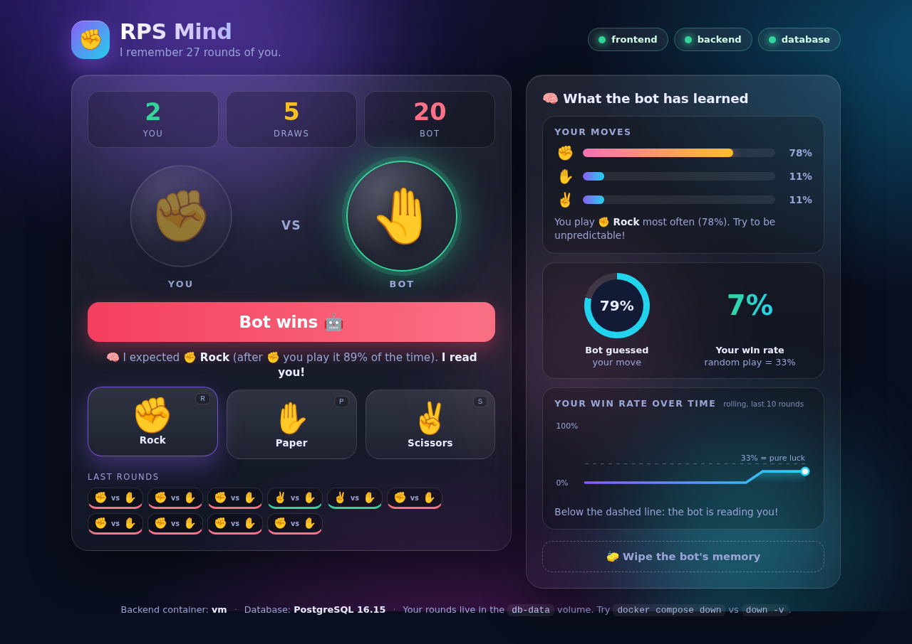

# ✊✋✌️ RPS Mind

**Rock-Paper-Scissors against a bot that learns how YOU play.**

The more you play, the better the bot reads you. Every round is saved in a
database, so the bot **remembers you** even after you stop and start the app.



This is a small **three-tier app** (database + backend + frontend) built to
learn **Docker Compose**. One file, [`compose.yaml`](compose.yaml), describes
the whole app. One command starts it.

---

## 🚀 Run it

You need **Docker Desktop** (running) and **Git**.

```bash
git clone https://github.com/djuraev/rps-bot.git
cd rps-bot
docker compose up -d --build
```

The first start takes about a minute (it downloads images and installs
dependencies). Then open **<http://localhost:8080>** and play!

Check that everything is healthy:

```bash
docker compose ps
```

You should see three services, all `Up ... (healthy)`.

Stop the app (your data is **kept**):

```bash
docker compose down
```

---

## 🎮 How to play

- Click **Rock**, **Paper** or **Scissors** (or press **R**, **P**, **S**).
- Watch the bot's thought under the result: *"I expected ✊ Rock... I read you!"*
- The right side shows **what the bot has learned**: your favorite move, how
  often the bot guessed you, and your win rate over time.
- Pure luck gives you a **33%** win rate. Can you stay random and beat the bot?

The three lights at the top show the status of the **frontend**, **backend**
and **database**. They turn red when a service stops. Try it in Exercise 4!

---

## 🧱 How it works

```
 Your browser ──► frontend ──────► backend ──────► db
                  nginx            Node.js          PostgreSQL
                  :8080            Express          (rounds table)
                  web page         the bot's brain
                  + /api proxy     + REST API
```

| Service    | What it is                  | Built from / image    | Port opened to your computer |
|------------|-----------------------------|-----------------------|------------------------------|
| `db`       | PostgreSQL database         | `postgres:16-alpine`  | none                         |
| `backend`  | API + the bot's brain       | `backend/Dockerfile`  | none                         |
| `frontend` | web page + proxy to the API | `frontend/Dockerfile` | **8080**                     |

Only the frontend is reachable from your browser. The backend and the database
live on private Docker networks.

### The start order

```
db  ──(healthy)──►  backend  ──(healthy)──►  frontend
```

1. **db** starts first. Its healthcheck (`pg_isready`) says when it is *ready*.
2. **backend** waits for the database to be *healthy*, then starts.
3. **frontend** waits for the backend to be *healthy*, then starts.

"Started" is not the same as "ready", and that is exactly why we use
`depends_on` with `condition: service_healthy`.

### The bot's brain (`backend/bot.js`)

The bot predicts your next move from your history, then plays the move that
beats it:

1. **Not enough data** (fewer than 3 rounds): it guesses.
2. **Pattern:** *"After you play ✊, what do you usually play next?"*
3. **Frequency:** *"Which move do you play most often?"*

It is under 50 lines of plain JavaScript. Read it, then try to fool it!

---

## 🧩 Docker Compose ideas used in `compose.yaml`

| Idea                             | Where to look                                         | What it does                                                        |
|----------------------------------|-------------------------------------------------------|---------------------------------------------------------------------|
| `image:` vs `build:`             | `db` uses an image, `backend` / `frontend` are built  | ready-made image vs. building your own from a Dockerfile            |
| `environment:` with defaults     | `${POSTGRES_PASSWORD:-devpass}`                       | settings, with a default if you do not set one                      |
| Named volume                     | `db-data`                                             | the database files survive `docker compose down`                    |
| Bind mount, read-only            | `./db/init.sql:/docker-entrypoint-initdb.d/init.sql:ro` | creates the table on the very first start                         |
| `healthcheck:`                   | all three services                                    | Docker asks each service: *are you ready?*                          |
| `depends_on` + `service_healthy` | `backend`, `frontend`                                 | start in the right order, and wait until *ready*                    |
| Service names as hostnames       | `DB_HOST: db`, `proxy_pass http://backend:3000`       | containers find each other by name                                  |
| Two networks                     | `frontend-net`, `backend-net`                         | the frontend cannot reach the database                              |
| `ports:`                         | only `frontend`                                       | the only door open to the outside                                   |
| `restart: unless-stopped`        | all services                                          | start again after a crash                                           |

---

## 🧪 Try it yourself

Do these in order. Each one teaches one idea.

### 1. Watch the start order

```bash
docker compose down
docker compose up
```

(no `-d`, so you see the logs). Watch the lines appear: `db` first, then
`backend` ("connected to database"), then `frontend`. Stop with **Ctrl+C**.

### 2. `down` vs `down -v`

1. Play 10 rounds.
2. `docker compose down`, then `docker compose up -d`. Reload the page.
   **The bot still knows you.** The data lives in the `db-data` volume.
3. `docker compose down -v`, then `docker compose up -d`.
   **The bot forgot you.** The `-v` deleted the volume.

### 3. Break the start order

1. In `compose.yaml`, comment out (put `#` in front of) the **whole `depends_on:`
   block of `backend`** and its **`restart:` line**.
2. `docker compose down -v`, then `docker compose up -d`.
3. `docker compose logs backend` shows:
   `cannot reach the database ... Exiting.`
   (Compose may also print `dependency failed to start`. That is expected:
   the frontend waits for a backend that never became healthy.)
4. Put the lines back. Then `docker compose down -v` and `docker compose up -d`:
   it works again. That is what `depends_on` + a healthcheck buys you.

> Tip: `git checkout compose.yaml` restores the original file.

### 4. Stop a service and watch the lights

```bash
docker compose stop backend
```

The **backend** light turns red and the bot says *"The bot is sleeping"*.

```bash
docker compose start backend
```

The light turns green and you can play again. Now try the same with `db`.
Notice the backend light stays green while the **database** light turns red,
and the backend recovers by itself when `db` comes back.

### 5. Crash a service and let Docker restart it

```bash
docker compose exec backend kill 1
docker compose ps
```

The backend stops, and `restart: unless-stopped` starts it again. Run
`docker compose ps` a few times to watch it come back.

### 6. Look inside the database

```bash
docker compose exec db psql -U rps -d rps -c "SELECT * FROM rounds ORDER BY id DESC LIMIT 5;"
docker compose exec db psql -U rps -d rps -c "SELECT strategy, COUNT(*) FROM rounds GROUP BY strategy;"
```

You can see every round, and which strategy the bot used.

### 7. See the network walls

```bash
docker compose exec frontend ping -c 1 backend    # works
docker compose exec backend  ping -c 1 db         # works
docker compose exec frontend ping -c 1 db         # FAILS: bad address 'db'
```

The frontend and the database share no network, so they cannot see each other.

### 8. Change the bot, rebuild

Open `backend/bot.js` and change something, for example `samples >= 4` to
`samples >= 2` (the bot trusts patterns sooner). Then:

```bash
docker compose up -d --build
```

Only the **backend** is rebuilt, and the `npm ci` step is **cached** because
`package.json` did not change. (Remember the layer-cache lesson from the
Dockerfile class!)

### 9. A gotcha: `init.sql` only runs once

Add a column to `db/init.sql`, then run `docker compose up -d --build`.
Nothing changes! PostgreSQL only runs init scripts when its data folder is
**empty**. To load the new file: `docker compose down -v`, then `up -d` again.

---

## ⚙️ Settings (optional)

The defaults work out of the box. To change them, copy `.env.example` to `.env`:

```bash
cp .env.example .env        # Windows PowerShell: Copy-Item .env.example .env
```

| Variable            | Default  | Meaning                              |
|---------------------|----------|--------------------------------------|
| `WEB_PORT`          | `8080`   | the port you open in your browser    |
| `POSTGRES_USER`     | `rps`    | database user                        |
| `POSTGRES_PASSWORD` | `devpass`| database password                   |
| `POSTGRES_DB`       | `rps`    | database name                        |

`.env` is listed in `.gitignore`, so your real passwords never reach GitHub.

---

## 🗂️ Project structure

```
rps-bot/
├── compose.yaml            the whole app in one file
├── .env.example            optional settings
├── db/
│   └── init.sql            creates the "rounds" table (first start only)
├── backend/
│   ├── Dockerfile
│   ├── package.json
│   ├── server.js           REST API (health, play, stats, reset)
│   ├── bot.js              the bot's brain
│   └── bot.test.js         tests for the brain (npm test)
└── frontend/
    ├── Dockerfile
    ├── nginx.conf          serves the page, forwards /api to the backend
    └── public/             index.html, style.css, script.js
```

### The API (for curious people)

| Method | Path          | What it does                                 |
|--------|---------------|----------------------------------------------|
| GET    | `/api/health` | `200` only when the backend AND database work|
| POST   | `/api/play`   | body `{"move":"rock"}`: plays one round      |
| GET    | `/api/stats`  | totals, move counts, bot accuracy, last 50   |
| POST   | `/api/reset`  | wipes the bot's memory                       |

---

## 🛟 Troubleshooting

| Problem                                      | Fix                                                                 |
|----------------------------------------------|---------------------------------------------------------------------|
| `Cannot connect to the Docker daemon`        | Start Docker Desktop and wait until it says *running*.              |
| `port is already allocated` (8080)           | Use another port: set `WEB_PORT=8081` in `.env`, or `WEB_PORT=8081 docker compose up -d` (PowerShell: `$env:WEB_PORT=8081`). |
| The page does not load right after `up`      | The first start takes a minute. Run `docker compose ps` and wait for `(healthy)`. |
| A service is not healthy                     | `docker compose logs db` or `docker compose logs backend`.          |
| `docker-compose: command not found`          | Use `docker compose` (with a **space**), not `docker-compose`.      |
| Start completely fresh                       | `docker compose down -v` then `docker compose up -d --build`.       |

Run the bot's tests without Docker (needs Node.js 20+):

```bash
cd backend && npm install && npm test
```
